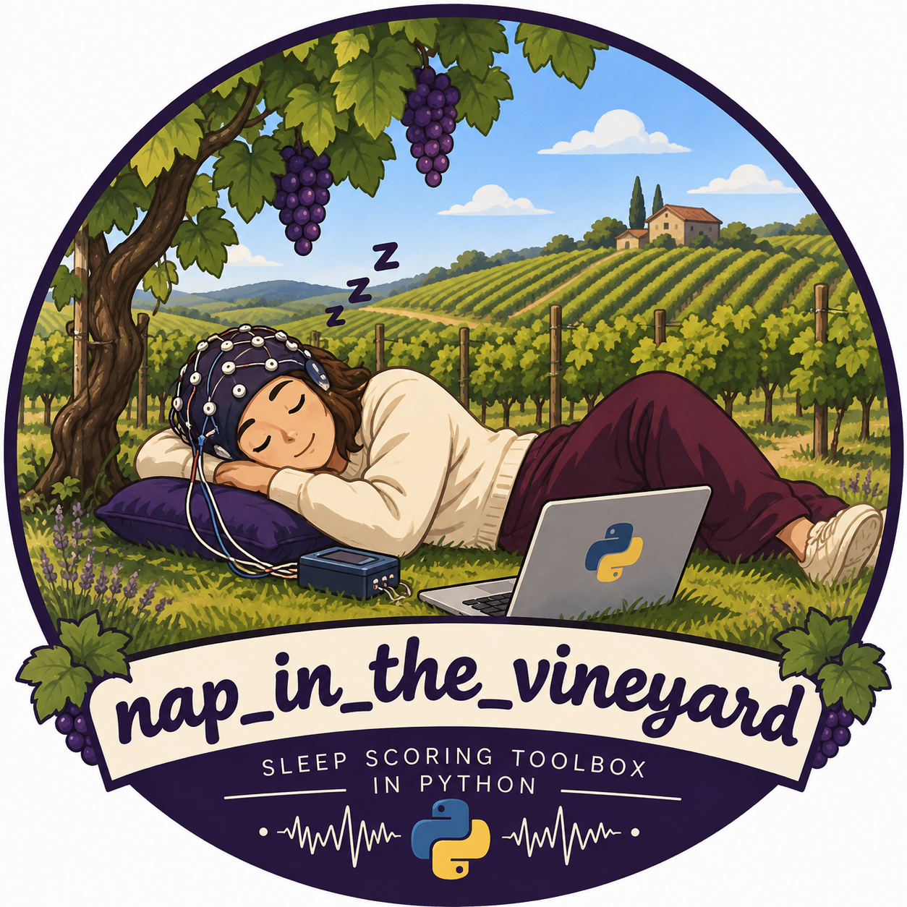

# Nap in the Vineyard 🍇

A lightweight Python launcher for visualizing and scoring sleep / EEG recordings, adapted from the [sleep-scoring](https://pypi.org/project/sleep-scoring/) software and configured for the data formats and workflows used in the UR2NF / LN2T lab. 

<p align="center">  </p>

## What is this?
Nap in the vineyard is a small standalone wrapper around the Python [sleep-scoring](https://pypi.org/project/sleep-scoring/) software. 
It provides a simple way to: 
- open EEG recordings in common electrophysiological formats, 
- optionnally load an existing hypnogram,
- visualize recordings for sleep scoring. 
The project is intented for lab use. 

## What to see:
- `run_sleep_sco.py`: the application launcher and hypnogram conversion logic
- `launch.sh`: starts the application with the project environment
- `setup.sh`: creates the environment and installs dependencies
- `requirements.txt`: pinned package versions
- `README.md`: this guide

Every user should create their own `.venv` with the setup script.

## Prerequisites
Python 3.9 is required. 
Install Python 3.9 from [python.org](https://www.python.org/downloads/release/python-3913/) or another trusted Python distribution. 
Confirm it is available:

```bash
python3.9 --version
```
The GUI uses Qt and VisPy, and the tested Anaconda Python 3.13 setup can abort with a macOS `malloc: Double free` error.
The tested environment was macOS on Apple Silicon. The pinned packages come from PyPI; other operating systems may need platform-specific adjustments. In VS Code, install the Microsoft **Python** extension.

## One-time installation
Open Terminal, move to the folder containing these files, and run:

```bash
cd /path/to/nap_in_the_vineyard
./setup.sh
```

The script creates `.venv`, upgrades `pip`, and installs every package listed in `requirements.txt`.

If Python 3.9 is installed but is not on `PATH`, provide its full path:

```bash
PYTHON_BIN=/full/path/to/python3.9 ./setup.sh
```

Installation is normally needed only once per computer. 
Re-run the setup script after changing the requirements file.

## Run the application
The wrapper always uses the local `.venv` and `run_sleep_sco.py`. It can be called from any directory. Use absolute paths for data files when working from elsewhere:

```bash
/path/to/nap_in_the_vineyard/launch.sh \
  /path/to/recording.edf \
  --hypnogram /path/to/stages.csv
```

For a recording without a hypnogram, the program opens a hypnogram picker. Cancel it to continue without one:

```bash
/path/to/nap_in_the_vineyard/launch.sh /path/to/recording.edf
```

The window stays attached to the terminal while it is open. Close the window to end the process. 
Do not set `QT_QPA_PLATFORM = offscreen`; the application needs a real desktop/OpenGL display.

## Supported files
Recording formats include `.edf`, `.bdf`, `.gdf`, `.vhdr`, `.eeg`, `.cnt`, `.set`, `.egi`, `.rec`, and `.trc`. Some formats require companion files in the same folder, such as BrainVision `.vhdr`, `.eeg`, and `.vmrk`.

Hypnograms can be `.csv` or `.txt`. A TXT file contains one stage per line, either labels (`W`, `N1`, `N2`, `N3`, `R`, `U`) or numeric values (`-1` to `4`) with: 
- W / WAKE = 0 
- N1 = 1
- N2 = 2
- N3 = 3
- R / REM = 4
- ART / A / U / UNKNOWN = -1 
Epoch labels are expanded using the default 30-second epoch duration.

The converted sample-level CSV can also be used directly:

```bash
./launch.sh recording.edf --hypnogram stages_converted.csv
```
For timestamped hypnograms, the timestamps are used to align the hypnogram with the time stored in the EEG file. 
The default timestamp correction is +1 hour, which specific to the data workflow for which this adaptation was developed. 
Check the timestamps before using a different value. This can be changed: 

```bash
./launch.sh recording.edf --hypnogram stages.csv --csv-to-edf-offset-hours 2
```

## VS Code
Use **Python: Select Interpreter** and choose:

```text
/path/to/nap_in_the_vineyard/.venv/bin/python
```

The workspace setting points VS Code to this interpreter. Run `./launch.sh` from the integrated terminal, or run `run_sleep_sco.py` after selecting this interpreter. 

```bash
python run_sleep_sco.py recording.edf --hypnogram stages.txt
```

Do not run `/usr/bin/python3 run_sleep_sco.py`; it may not contain the installed dependencies and can use an incompatible Qt/OpenGL environment.

## Lab-specific adaptations
This project adapt the original software to the EEG files used in our lab. 
For EEG-MEG recordings whose filename contains *tsss*, the channel names are kept unchanged.
For Muse® recordings whose filename contains *eeg*, a standard 10-20 montage is applied and the following channel names are automatically renamed: 
- eegch1 = T9
- eegch2 = Fp1
- eegch3 = Fp2
- eegch4 = T10

If needed, modify the EEG_CHANNEL_RENAME in `run_sleep_sco.py`

## Expected warnings
Some EEG files may report that channels have no standard 10-20 montage position. The launcher keeps those channels and continues. The laucher may also warn about data amplitude; inspect the recording units before making scientific interpretations.

## Origin and attribution
This project is an adaptation of [sleep-scoring] (https://github.com/x64-bit/sleep-scoring/tree/main) software. 
The original work is: 
Combrisson E, Vallat R, Eichenlaub J-B, O’Reilly C,Lajnef T, Guillot A, Ruby P and Jerbi K (2017).  
         Sleep: An Open-Source Python Software for Visualization, Analysis, and Staging of Sleep Data. Front. Neuroinform. 11:60.  
         doi:[10.3389/fninf.2017.00060] (https://www.frontiersin.org/journals/neuroinformatics/articles/10.3389/fninf.2017.00060/full) 

This repository is intented to be useful to UR2NF / LN2T members. 
Please fork the repository and adapt it to your own workflow. 

Adapted by Marine Thieux with contributions from Dimitri Voisin, and Burgundy roots. 